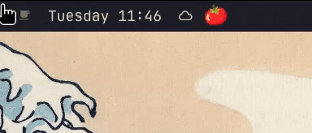
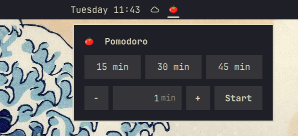
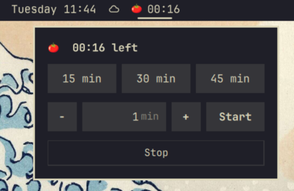
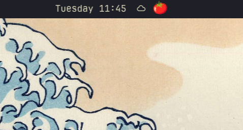

# 🍅 Omarchy Pomodoro

A pomodoro widget for the [Omarchy](https://omarchy.org) bar. A little tomato sits in the bar and shows the time left next to it while a session runs.

- Hover the tomato to open a popup with 15, 30 and 45 minute presets, or pick a custom time (1–600 min).
- When the time is up, it plays a soft chime and the tomato grows and keeps shaking until you click it.
- Right-click during a session to stop the timer.

<p align="center">
  
</p>

| Pick a time | Session running |
|---|---|
|  |  |

When idle, only the tomato stays in the bar:



## Install

```bash
omarchy plugin add https://github.com/fabiosimoesds/omarchy-pomodoro.git --enable
```

The installer asks which bar section to put the widget in. To pick an exact spot:

```bash
omarchy plugin enable fabiosimoesds.pomodoro --section center --after omarchy.weather
```

## Language

The widget follows your system language (`LANG`) and falls back to English. Supported:

| Code | Language | Code | Language |
|---|---|---|---|
| `en` | English | `pl` | Polski |
| `pt` | Português | `ru` | Русский |
| `es` | Español | `uk` | Українська |
| `fr` | Français | `tr` | Türkçe |
| `de` | Deutsch | `ja` | 日本語 |
| `it` | Italiano | `zh` | 中文 |
| `nl` | Nederlands | `ko` | 한국어 |

To use a different language than the system one:

```bash
omarchy bar set fabiosimoesds.pomodoro language pt
```

Missing your language? Add a line to [`Strings.js`](Strings.js) and open a pull request.

## Update and remove

```bash
omarchy plugin update fabiosimoesds.pomodoro
omarchy plugin remove fabiosimoesds.pomodoro
```

If the widget still shows the old version after an update, restart the shell with `omarchy restart shell`.

## Requirements

Nothing beyond a standard Omarchy install: the chime uses `pw-play` (or `paplay`) with `/usr/share/sounds/freedesktop/stereo/complete.oga`, and the tomato uses the Noto Color Emoji font.

## License

[MIT](LICENSE)
